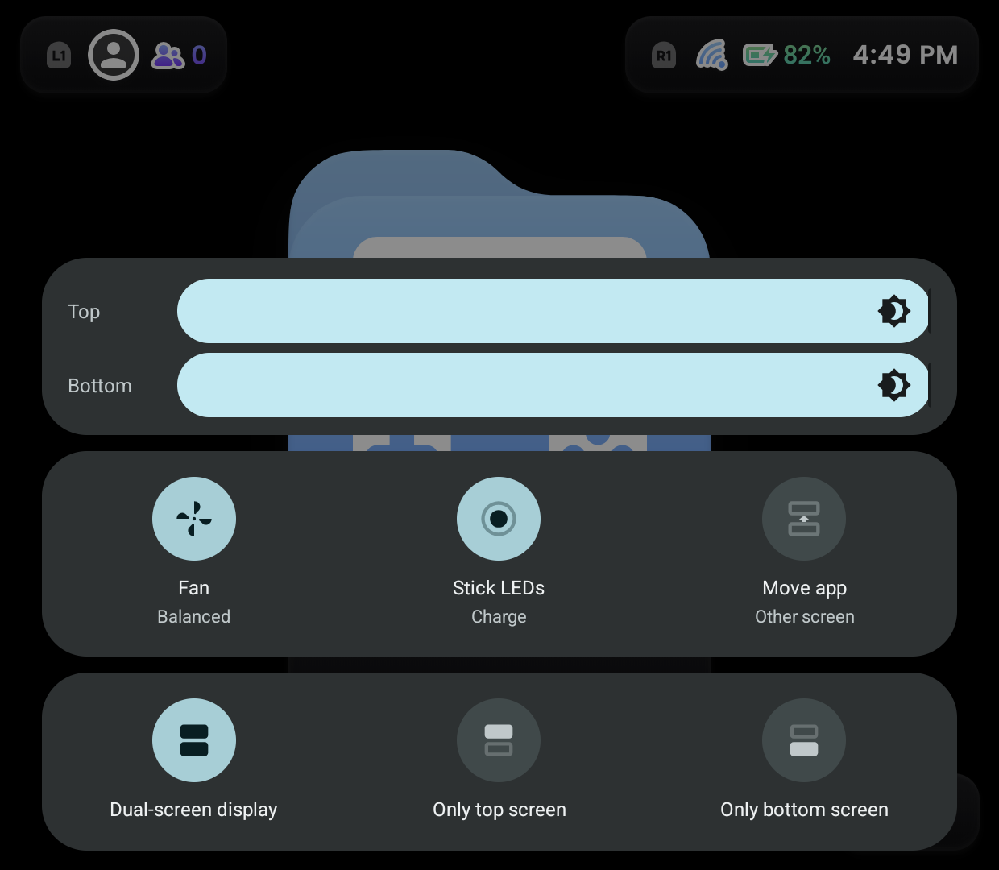
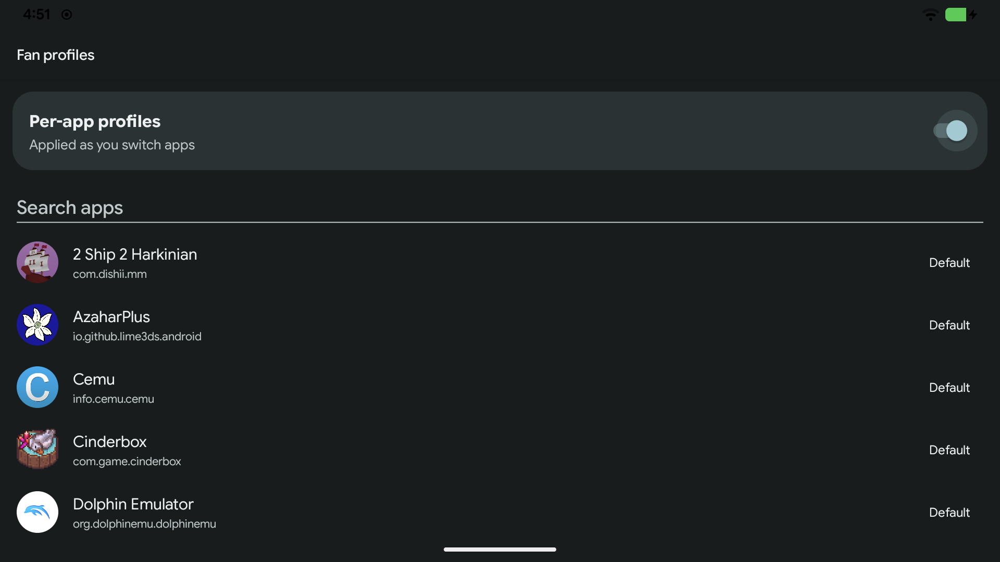

# thor-features

Stock AYN features, rebuilt for **LineageOS 24** on the **AYN Thor**.

The Thor's own ROM has fan control, joystick lighting, a dual-screen panel and a
programmable AYN button. LineageOS has none of them. This brings them back.



---

## What you get

Most features come in two halves: a **Magisk module** that does the work, and an
**app** that gives you something to tap. You can install just the module if you
prefer, except where noted.

### The things with a screen

| | Module | App |
|---|---|---|
| **AYN button panel** — press the AYN button to pick a screen mode and set each screen's brightness. | `thor-screenblank`, `thor-screenmove`, `thor-aynkey`, `thor-screenbright` | `thor-screenpanel` |
| **Fan control** — choose how eagerly the fan spins: quiet, balanced, or performance. | `thor-fanctl` | `thor-fan-tile` |
| **Joystick lighting** — light the stick rings while charging, or let them breathe. | `thor-stickfx` | `thor-stickfx-tile` |
| **Move an app to the other screen** — one tap sends whatever you're using across. | `thor-screenmove` | `thor-screenmove-tile` |
| **Per-game fan profiles** — pick a fan setting per game; it switches when you launch. | `thor-appwatch` | `thor-appprofiles` |

Quick Settings tiles show the current setting at a glance, and tapping one opens
a picker:


Per-game fan profiles switch automatically as you move between games:



### The things that just fix something

No app, nothing to configure. Install and forget.

| Module | What it fixes |
|---|---|
| `thor-wifi-kiwi-fw` | 6 GHz Wi-Fi, which otherwise fails to connect. |
| `thor-sdcard-fsck` | Large exFAT SD cards that refuse to mount. |
| `thor-display-density` | Adds main-screen density options Settings doesn't offer. |
| `thor-screenbright` | Lets the two screens have separate brightness instead of moving together. |

Two older modules are kept for reference only and you should skip both:
`thor-wifi-no6g` (replaced by `thor-wifi-kiwi-fw`) and `thor-display-match`.

---

## Installing

You need an AYN Thor running LineageOS 24 with **Magisk** installed.

**1. Download.** Grab the zips and APKs from the
[latest release](../../releases/latest).

**2. Flash the modules.** In the Magisk app: *Modules → Install from storage*,
pick a `.zip`, repeat for each one you want, then **reboot**.

**3. Install the apps.** Tap each `.apk` to install it, or from a computer:

```
adb install -r thor-fan-tile.apk
```

**4. Add the tiles.** Pull down Quick Settings, tap the edit (pencil) button,
and drag in the tiles you installed.

That's it. The AYN button panel appears when you press the AYN button, below the
bottom screen.

### If something doesn't work

- **A tile does nothing.** Its module probably isn't installed, or Magisk is
  still waiting for a reboot.
- **An app won't install.** If you had an older version, uninstall it first —
  the signing key changed and Android won't upgrade across that.
- **The AYN panel doesn't appear.** It needs four modules present; its own
  installer will tell you which one is missing.

Each component folder has its own README with more detail.

---

## Everything else

- [`DEVELOPING.md`](DEVELOPING.md) — building, testing, CI, how the pieces
  depend on each other.
- [`docs/ayn-button-panel.md`](docs/ayn-button-panel.md) — the AYN button and
  its panel, in depth.
- [`THIRD-PARTY.md`](THIRD-PARTY.md) — the five files here that aren't ours, and
  their terms. Read it before redistributing.
- [`LICENSE`](LICENSE) — Apache-2.0.

Everything here is installed and in daily use on the author's own Thor. It is a
personal project for one device on one ROM, and is not affiliated with AYN or
with LineageOS.
